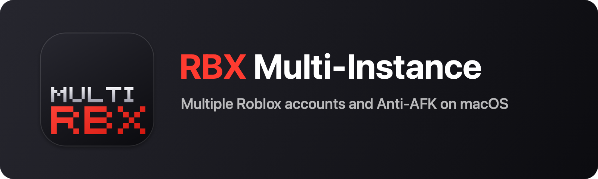
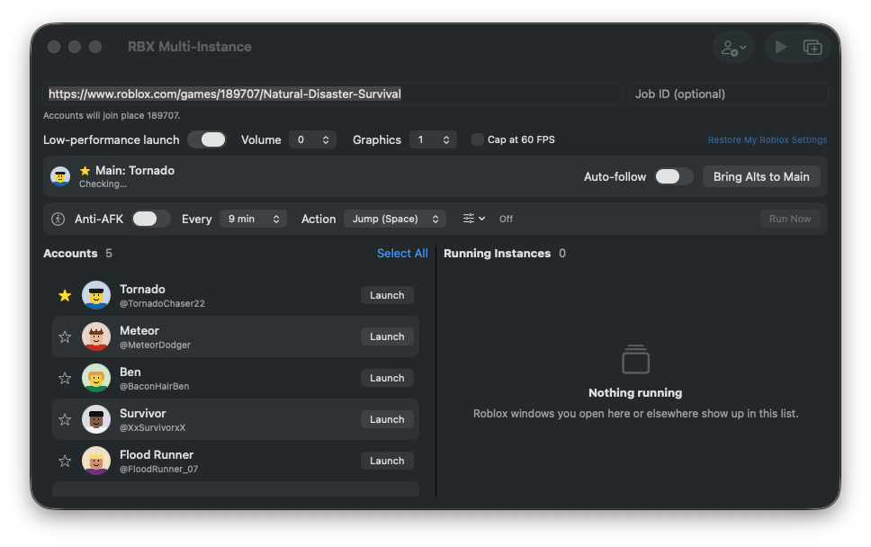
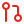

<div align="center">



[](#requirements)
[](#requirements)
[](#building-from-source)
[](LICENSE)

Run multiple Roblox accounts on your Mac. Each account gets its own window and login. Manage them from the menu bar.



<a href="../../releases/latest"></a>

[Features](#features) · [Download](#download) · [Getting started](#getting-started) · [Privacy](#privacy-and-data) · [Troubleshooting](#troubleshooting) · [Build from source](#building-from-source)

</div>

---

##  Why I made this

Most Roblox multi-instance and anti-AFK tools are made for Windows. I wanted one for macOS, so I built it.

This project is based on [AntiAFK-RBX](https://github.com/Agzes/AntiAFK-RBX) by Agzes. I rewrote the app in Swift and adapted its multi-instance and anti-AFK features for macOS.

<a id="features"></a>

##  Features

| Feature | Description |
| --- | --- |
| &nbsp; **Multiple accounts** | Sign in through Roblox or add an account with a `.ROBLOSECURITY` cookie. Launch one account, selected accounts, or all inactive accounts. Launches are spaced 4 seconds apart. |
| &nbsp; **Separate sessions** | Each account has its own profile folder and login session. |
| &nbsp; **Join a game** | Enter a place ID, game URL, private server link, or Job ID to join a specific server. |
| &nbsp; **Main account and auto-follow** | Choose a Main account and bring your other accounts into its server. Auto-follow moves them when Main changes servers or teleports. |
| &nbsp; **Anti-AFK** | Send a key press (jump, step, or zoom) every 3–18 minutes. The app can wait until you've stopped typing, then return focus to the app you were using. |
| &nbsp; **Low-performance mode** | Launch Roblox with lower volume and graphics settings. You can also set a 60 FPS cap. Original settings are restored afterwards. |
| &nbsp; **Menu bar controls** | View, launch, focus, and close Roblox windows from the menu bar. |

<a id="requirements"></a>

##  Requirements

- macOS 13 Ventura or later
- Apple Silicon or Intel Mac
- Roblox installed in `/Applications`

<a id="download"></a>

##  Download

1. Download `RBX-Multi-Instance-<version>-mac.dmg` from [Releases](../../releases).
2. Open the DMG and drag **RBX Multi-Instance** into **Applications**.
3. Eject the DMG.
4. Open the app from **Applications**.

> [!NOTE]
> The app isn't notarized by Apple, so macOS may block it the first time you open it.

###  Allow the app to open

<details open>
<summary><b>macOS 15 Sequoia or later</b></summary>

1. Open the app from **Applications**. When macOS blocks it, click **Done**.
2. Go to **System Settings → Privacy & Security**.
3. Under **Security**, find the message saying the app was blocked. Click **Open Anyway**.
4. Authenticate if asked, then confirm **Open Anyway**.

> [!TIP]
> If **Open Anyway** isn't there, open the app again to bring up the warning. The button may only appear for about an hour after the warning.

</details>

<details>
<summary><b>macOS 13 Ventura and macOS 14 Sonoma</b></summary>

1. Open **Applications** in Finder.
2. Right-click **RBX Multi-Instance** and choose **Open**.
3. Click **Open** in the dialog.

</details>

You only need to do this once.

<details>
<summary><b>If macOS says the app is damaged</b></summary>

You can remove the quarantine flag in Terminal:

```sh
xattr -dr com.apple.quarantine "/Applications/RBX Multi-Instance.app"
````

This only affects this app. It doesn't turn off Gatekeeper for other apps.

> [!WARNING]\
> Removing the quarantine flag means you're choosing to trust the app. Only download it from this repository's Releases, or build it yourself.

###  Other permissions

- Accessibility: Only needed for Anti-AFK. See Anti-AFK permission.
- Keychain: After an update, macOS may ask to access your saved Roblox cookies. Enter your Mac password and choose Always Allow. This can happen because each build has a different signature.
- Microphone and camera: Roblox may request access for voice chat or face tracking.

###  Updating

Download the latest DMG and drag the app into Applications. Choose Replace when prompted. Your accounts and settings should stay intact. You may need to allow the app to open again or re-enable Accessibility for Anti-AFK.

<a id="getting-started"></a>

##  Getting started

1. Select Add Account → Log In with Roblox… and sign in. Repeat for each account.
2. Enter a place ID or game link if you want to join a specific game.
3. Select the accounts you want to open and click Launch Selected. To open just one, use Launch on its row.

<a id="anti-afk-permission"></a>

###  Anti-AFK permission

Anti-AFK sends key presses to Roblox, so it needs macOS Accessibility access. You don't need this permission to launch accounts.

1. Turn on Anti-AFK or click Grant Accessibility… in the app.
2. Open System Settings → Privacy & Security → Accessibility.
3. Turn on RBX Multi-Instance. If it isn't listed, click + and add it from Applications.
4. Return to the app and turn Anti-AFK on.

> [!TIP]\
> After an update, macOS may show this permission as enabled even if it no longer works. If Anti-AFK still asks for access, remove the app from the Accessibility list with –, add it again with +, then turn it back on.

<a id="privacy-and-data"></a>

##  Privacy and data

Your Roblox login cookie can give someone full access to your account. Here's where the app stores its data:

| Data                                   | Location                                                      |
| -------------------------------------- | ------------------------------------------------------------- |
| Login cookies                          | macOS Keychain                                                |
| Account list (IDs, names, avatar URLs) | `~/Library/Application Support/RBX-Multi/accounts.json`       |
| Roblox profiles for each account       | `~/Library/Application Support/RBX-Multi/Profiles/<user id>/` |
| Preferences                            | `~/Library/Preferences/com.decypted.rbx-multi.mac.plist`      |

The app connects to Roblox domains (`roblox.com` and its subdomains) and `rbxcdn.com` for avatar images. It doesn't collect analytics or telemetry. There's no update checker.

Low-performance mode changes Roblox's volume, graphics quality, and frame rate settings in `~/Library/Roblox/GlobalBasicSettings_*.xml`. The app saves your original settings, then restores them about 15 seconds after launch and when all low-performance windows are closed. If they aren't restored, use Restore My Roblox Settings in the app.

> [!CAUTION]
> Keep your `.ROBLOSECURITY` cookie private. Don't share it or paste it into an app or website you don't trust. Only download this app from this repository's Releases, or build it yourself.

<a id="troubleshooting"></a>

##  Troubleshooting

##  Uninstalling

1. Quit the app from the menu bar and move it from Applications to the Trash.
2. Delete `~/Library/Application Support/RBX-Multi/`.
3. Open Keychain Access, search for `com.decypted.rbx-multi.cookies`, and delete those entries.
4. If you enabled Accessibility, remove the app from System Settings → Privacy & Security → Accessibility.

<a id="building-from-source"></a>

##  Building from source

You'll need Xcode Command Line Tools and Python 3.

```
xcode-select --install
./build.sh
```

The script builds a universal app, creates the icon, signs the app locally, and saves the DMG in `dist/`. On the first run, it creates a virtual environment at `packaging/.venv` for `dmgbuild`.

To sign with a Developer ID certificate:

```
SIGN_ID="Developer ID Application: Your Name (TEAMID)" ./build.sh
```

The app version is set by `CFBundleShortVersionString` in `Info.plist`.

###  Project structure

| Path                           | What it contains                                               |
| ------------------------------ | -------------------------------------------------------------- |
| `Sources/App.swift`            | App entry point, main window, and menu bar                     |
| `Sources/Models.swift`         | Account storage, launching, instance tracking, and auto-follow |
| `Sources/RobloxAPI.swift`      | Roblox API calls, launch targets, and Keychain                 |
| `Sources/RobloxSettings.swift` | Roblox settings and low-performance mode                       |
| `Sources/AntiAFK.swift`        | Anti-AFK timer and key presses                                 |
| `Sources/Views.swift`          | SwiftUI views                                                  |
| `packaging/`                   | DMG layout and packaging scripts                               |

##  Contributing

Bug reports and pull requests are welcome. For larger changes, open an issue first.

Please don't include your `.ROBLOSECURITY` cookie or a screenshot showing it in an issue.

##  Disclaimer

This project isn't affiliated with or endorsed by Roblox Corporation. Running multiple accounts or using automated input may conflict with Roblox's Terms of Use. Use it at your own risk.

##  License

MIT © 2026 decypted. See LICENSE.

Based on [AntiAFK-RBX](https://github.com/Agzes/AntiAFK-RBX?utm_source=chatgpt.com) by Agzes.